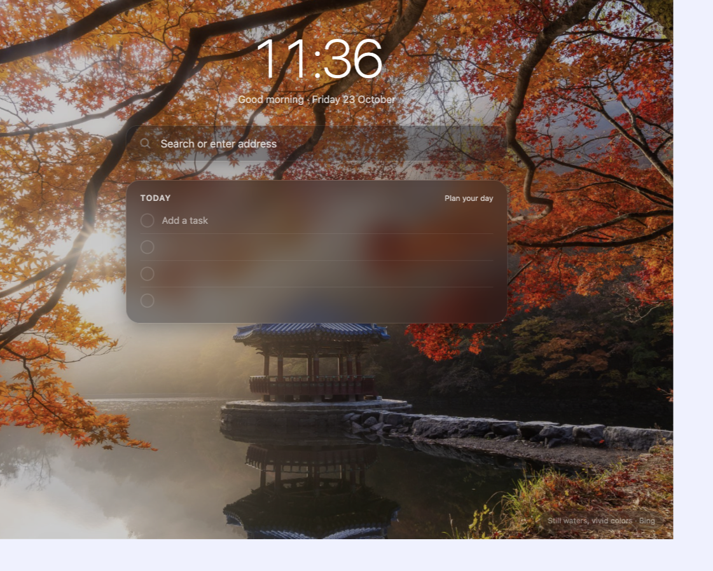
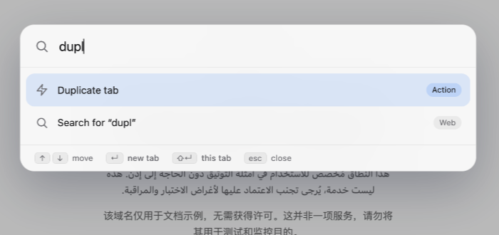
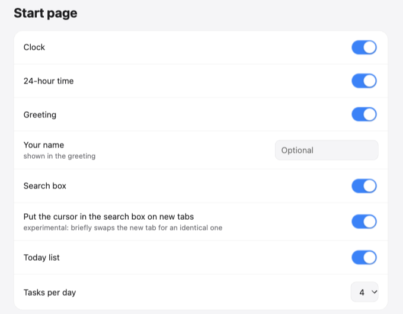

# Arc Lite

A Manifest V3 Chromium extension that brings a few of Arc's best touches to any Chromium browser: a floating action bar, a command bar, a customizable start page, and session restore. No build step, no dependencies, just plain JavaScript.

## Screenshots

| Start page | Command bar |
| --- | --- |
|  |  |

## Features

- **Action bar**: a small row of buttons pinned to the bottom-left of every page. Each button lives in its own file under `buttons/`.
  - **Media**: a mini player for each playing `<video>`/`<audio>` source (play/pause, seek, mute, picture-in-picture, and next/previous on YouTube, YouTube Music and Spotify). It works across frames.
  - **Downloads**: shows the latest download as a chip, with the three most recent downloads on hover. It can hide the browser's native downloads UI.
  - **Copy URL**: copies the current tab's URL (`Cmd+Shift+C` on Mac, `Ctrl+Shift+C` elsewhere) and shows a toast.
- **Command bar** (`Cmd/Ctrl+Shift+K`, plus a configurable in-page shortcut, default `Cmd/Ctrl+T`): one box that searches open tabs, actions, history, recently closed tabs and the web. It renders as an overlay iframe, or as a popup window on pages where scripts can't run (`chrome://`, the Web Store, PDFs).
- **Start page** (replaces the new tab page): clock, greeting, search box, top sites, a small to-do list, and a background that is a gradient, a solid colour, your own photo, or a daily photo from Bing, Wikipedia, NASA or Picsum.
- **Session restore**: snapshots all windows, tabs and tab groups, and reopens them on browser start if the browser didn't restore them itself.
- **Settings page**: opened from the toolbar icon (configurable to open the start page or the Downloads folder instead).

## Install

1. Open `chrome://extensions` (or your Chromium browser's equivalent).
2. Enable **Developer mode**.
3. Click **Load unpacked** and select this directory.

Requires Chrome 116 or newer. Keyboard shortcuts can be changed at `chrome://extensions/shortcuts`.

## Project layout

| File | Role |
| --- | --- |
| `manifest.json` | Permissions, content scripts, commands, new-tab override |
| `background.js` | Service worker: commands, clipboard, downloads, media routing, daily photo fetch and alarms |
| `session.js` | Session snapshot and restore (loaded into the service worker via `importScripts`) |
| `settings.js` | Shared settings: defaults merged over a single object in `chrome.storage.local`. It is loaded everywhere and safe to inject twice |
| `action-bar.js`, `buttons/*.js` | Action bar host (closed shadow DOM) and the individual buttons |
| `media-agent.js` | Runs in every frame, finds the main media element, reports state and executes controls |
| `command-bar.js`, `commandbar.{html,css,js}` | Command bar trigger/overlay (content script) and the UI (extension page) |
| `newtab.{html,css,js}`, `newtab-boot.js` | Start page. The boot script swaps the browser's new tab for an identical `?f=1` tab so the search box can take focus |
| `prefs.{html,css,js}` | Settings UI |
| `offscreen.{html,js}` | Clipboard fallback for pages that can't be scripted |
| `icons/` | Extension icons and early icon concepts |

## How it works

- **Messaging**: content scripts and extension pages talk to the service worker through `chrome.runtime.sendMessage`. Message types include `media-report`, `media-control`, `get-downloads`, `toggle-command-bar`, `refresh-photo` and `restore-session`.
- **Reload safety**: content scripts detect "orphaned" copies left behind by an extension reload (`chrome.runtime.id` becomes unavailable) and replace or ignore them.
- **Copy URL** runs in the page first (it holds `activeTab`), and falls back to an offscreen document.
- **Daily photo**: the service worker fetches the image, caches it, and refreshes it at midnight using `chrome.alarms`, with retries on failure.

## Permissions

`<all_urls>` is needed for the action bar, media agent and command bar content scripts. Other permissions: `tabs`, `tabGroups`, `sessions`, `history`, `topSites`, `search` and `favicon` (command bar, start page, session restore), `downloads*` (downloads button), `offscreen`, `scripting` and `activeTab` (clipboard), `storage` and `unlimitedStorage` (settings, photos, session snapshot), and `alarms` (daily photo).

Network requests are limited to the daily-photo sources you pick (Bing, Wikimedia, NASA, Picsum), and are sent without credentials. Nothing is sent anywhere else.

## Development

There is no build. Edit the files, then click the reload icon for the extension on `chrome://extensions`. Debug the service worker from its **Inspect views** link, and the settings, start and command-bar pages with normal DevTools.
